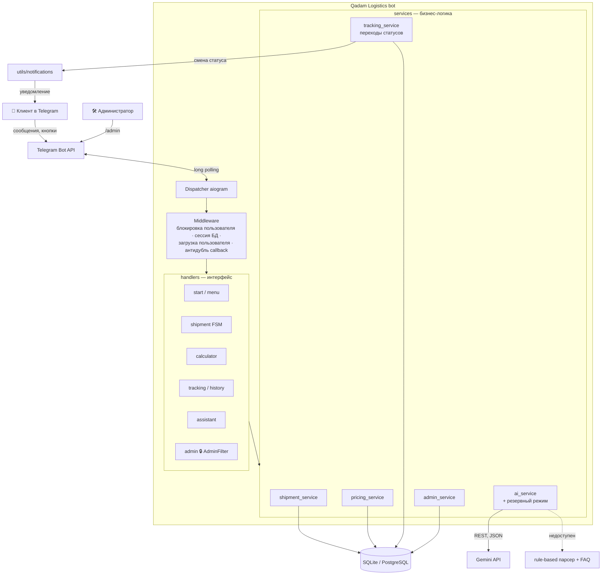
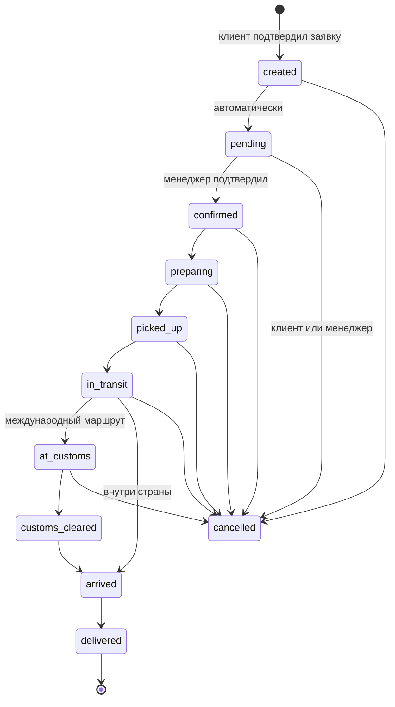
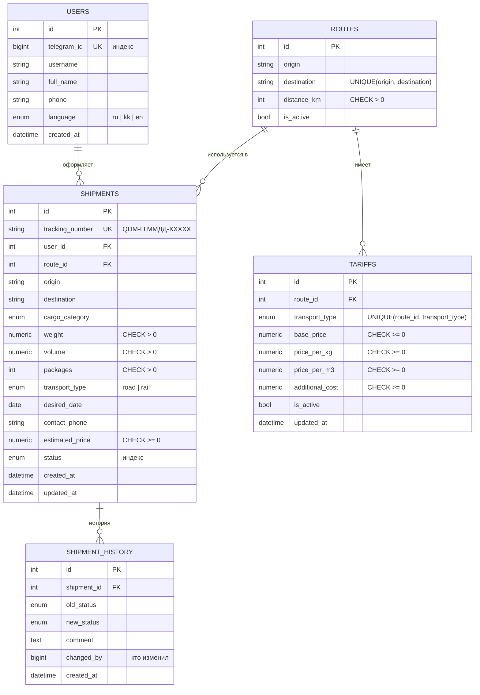

# Qadam Logistics 🚚

**Цифровая логистическая платформа в Telegram для малого и среднего бизнеса Казахстана.**
Оформляйте поставки, рассчитывайте стоимость и контролируйте движение груза в одном Telegram-боте.

> MVP для международного хакатона, направление **Digital Economy & Future Tech**.
> Qadam (каз. «қадам») — «шаг»: каждый этап доставки виден клиенту шаг за шагом.

---

## 1. Проблема

Предпринимателю из Шымкента, который везёт товар в Ташкент (или обратно), приходится собирать информацию по кусочкам:
цену — у одного перевозчика, сроки — у экспедитора, статус груза — звонками водителю или брокеру на таможне.
В результате:

- **непрозрачная стоимость** — непонятно, из чего складывается цена и почему она такая;
- **нет единой точки контроля** — статус груза приходится выяснять вручную;
- **много ручной переписки** — заявки теряются в мессенджерах и звонках.

## 2. Решение

Telegram-бот, в котором весь путь заявки собран в одном месте:

1. **Оформление заявки** за 10 коротких шагов — или одним сообщением AI-помощнику.
2. **Прозрачный расчёт** — подробная разбивка: базовая ставка маршрута, стоимость по весу и по объёму, доп. расходы.
3. **Отслеживание** по номеру `QDM-261106-7KX4P` с визуальной шкалой этапов.
4. **Уведомления** — при каждом изменении статуса клиенту приходит сообщение.
5. **Админ-панель** в том же боте: подтверждение заявок, смена статусов, тарифы, статистика.

Почему Telegram: целевая аудитория уже в нём работает каждый день — не нужно устанавливать приложение и регистрироваться.

## 3. Целевая аудитория

- владельцы небольших магазинов;
- предприниматели, занимающиеся импортом и экспортом;
- владельцы интернет-магазинов;
- небольшие производственные компании.

## 4. Основные функции

| Раздел | Что умеет |
|---|---|
| 🚚 **Создать поставку** | FSM-сценарий из 10 шагов: откуда → куда → категория → вес → объём → упаковки → транспорт → дата → телефон → подтверждение. Отмена на любом шаге. После подтверждения — уникальный номер, запись в БД, расчёт, уведомление администраторам. |
| 💰 **Рассчитать стоимость** | Маршрут + вес + объём → сравнение авто и ж/д с подробной разбивкой. Кнопка «Оформить» переносит данные в заявку. |
| 📦 **Отследить груз** | Поиск по номеру (можно без дефисов и в нижнем регистре), карточка поставки и временная шкала этапов, история статусов. |
| 📋 **Мои поставки** | Список своих поставок с пагинацией; отмена заявки до её подтверждения. |
| 🤖 **AI-помощник** | Gemini API: извлекает маршрут, категорию, вес, объём, количество упаковок из свободного текста и отвечает на вопросы о сервисе. Без ключа — базовый режим (регулярные выражения + FAQ). |
| ℹ️ **О проекте** | Описание сервиса. |
| 🛠 **/admin** | Новые/активные/все заявки, подтверждение, смена статуса (только допустимые переходы), отмена, тарифы, пользователи, статистика. |
| 🌐 **Языки** | Русский, казахский, английский (выбор при /start или /language). Админ-панель — на русском. |

## 5. Технологический стек

- **Python 3.12+**, **aiogram 3.x** — асинхронный Telegram-бот (FSM, CallbackData, middleware)
- **SQLAlchemy 2.x** (async) + **SQLite** (aiosqlite) для MVP; **PostgreSQL** (asyncpg) — смена одной переменной
- **Alembic** — миграции схемы
- **Pydantic 2** — валидация заявки и ответа AI
- **python-dotenv** — переменные окружения
- **logging** — консоль + файл `logs/bot.log` с ротацией
- **pytest** + **pytest-asyncio** — тесты
- **Gemini API** — через REST (aiohttp уже входит в aiogram, отдельный SDK не нужен)

## 6. Архитектура



**Принцип слоёв:** хендлеры отвечают только за диалог (кнопки, тексты, состояния), вся логика — в `services/`,
которые ничего не знают о Telegram и поэтому легко тестируются. AI никогда не пишет в БД напрямую:
его ответ проходит через те же валидаторы, что и ручной ввод.

### Жизненный цикл заявки



Для внутренних маршрутов (например, Шымкент → Алматы) таможенные этапы автоматически скрываются из шкалы и меню статусов.

## 7. Структура проекта

```
qadam_logistics/
├── bot.py                    # точка входа: логирование, БД, запуск polling
├── app.py                    # сборка диспетчера: middleware, роутеры, обработчик ошибок
├── config.py                 # настройки из .env (Pydantic)
├── requirements.txt
├── .env.example
├── alembic.ini
├── pytest.ini
├── assets/qadam_avatar.png   # аватар бота в цветах бренда
├── database/
│   ├── models.py             # User, Shipment, ShipmentHistory, Route, Tariff
│   ├── engine.py             # async engine, PRAGMA foreign_keys для SQLite
│   ├── session.py            # middleware: одна сессия на обновление
│   ├── seed.py               # демо-маршруты и ТЕСТОВЫЕ тарифы
│   └── migrations/           # Alembic (versions/0001_initial_schema.py)
├── handlers/
│   ├── start.py              # /start, язык, /help
│   ├── menu.py               # главное меню, /menu, /cancel, «домой»
│   ├── shipment.py           # оформление поставки (FSM, 10 шагов)
│   ├── calculator.py         # калькулятор стоимости
│   ├── tracking.py           # отслеживание, история, отмена клиентом
│   ├── history.py            # «Мои поставки»
│   ├── assistant.py          # AI-помощник
│   ├── admin.py              # админ-панель
│   ├── fallback.py           # необработанные сообщения и кнопки
│   └── common.py             # общие помощники вывода
├── keyboards/
│   ├── main_menu.py  shipment.py  admin.py  inline.py (CallbackData)
├── services/
│   ├── shipment_service.py   # создание, доступ, отмена
│   ├── pricing_service.py    # расчёт стоимости
│   ├── tracking_service.py   # статусы, переходы, история
│   ├── ai_service.py         # Gemini + резервный режим
│   ├── admin_service.py      # статистика, тарифы
│   └── user_service.py
├── states/shipment_states.py # FSM-состояния
├── middlewares/__init__.py   # пользователь, блокировки, антидубль
├── i18n/                     # тексты ru / kk / en
├── utils/
│   ├── validators.py  tracking_id.py  notifications.py
│   ├── catalog.py            # города, категории, эмодзи, распознавание в тексте
│   ├── formatting.py         # карточки, шкала этапов, разбивка цены
│   └── filters.py            # AdminFilter, MenuButton
└── tests/                    # 55 тестов, включая сквозной сценарий бота
```

## 8. Схема базы данных



К обязательным полям ТЗ добавлены: `shipments.route_id`, `desired_date`, `contact_phone` (шаги 8–9 сценария),
`shipment_history.changed_by` (аудит) и `tariffs.updated_at`. Деньги хранятся в `Numeric` (Decimal), без ошибок float.

## 9. Логика расчёта стоимости

```
Стоимость = Базовая стоимость маршрута
          + max(Вес × цена за кг, Объём × цена за м³)
          + Дополнительные расходы
```

Лёгкий, но громоздкий груз (одежда, мебель) «упирается» в объём машины, тяжёлый и компактный (стройматериалы) —
в грузоподъёмность. Поэтому берётся **большее** из двух. Базовая ставка задаётся для каждого маршрута отдельно и отражает
расстояние. Пример: 150 кг одежды, 1,2 м³, Шымкент → Ташкент, авто:
`14 800 + max(150×27 = 4 050; 1,2×5 600 = 6 720) + 7 000 = 28 520 ₸`.

**Тестовые тарифы** (условные, НЕ рыночные цены; расстояния ориентировочные; меняются в /admin → Тарифы):

| Маршрут (в обе стороны) | км | Транспорт | База, ₸ | ₸/кг | ₸/м³ | Доп., ₸ |
|---|---|---|---|---|---|---|
| Шымкент ⇄ Ташкент | 120 | Авто | 14 800 | 27 | 5 600 | 7 000 |
| Шымкент ⇄ Ташкент | 120 | Ж/д | 23 000 | 19 | 3 900 | 10 000 |
| Шымкент ⇄ Алматы | 690 | Авто | 37 600 | 39 | 8 400 | 0 |
| Шымкент ⇄ Алматы | 690 | Ж/д | 37 200 | 27 | 5 900 | 3 000 |
| Шымкент ⇄ Астана | 1450 | Авто | 68 000 | 54 | 12 200 | 0 |
| Шымкент ⇄ Астана | 1450 | Ж/д | 56 200 | 38 | 8 600 | 3 000 |
| Шымкент ⇄ Самарканд | 420 | Авто | 26 800 | 33 | 7 100 | 7 000 |
| Шымкент ⇄ Самарканд | 420 | Ж/д | 30 500 | 23 | 5 000 | 10 000 |
| Шымкент ⇄ Бишкек | 480 | Авто | 29 200 | 35 | 7 400 | 7 000 |
| Ташкент ⇄ Алматы | 810 | Авто | 42 400 | 41 | 9 000 | 7 000 |
| Ташкент ⇄ Алматы | 810 | Ж/д | 40 200 | 29 | 6 300 | 10 000 |

Каждый расчёт в боте помечен: «предварительная оценка по демонстрационным ТЕСТОВЫМ тарифам, не является подтверждённым
предложением перевозчика».

## 10. Установка

Нужен Python 3.12 или новее.

```bash
cd qadam_logistics
python -m venv .venv
# Windows:  .venv\Scripts\activate
# macOS/Linux:
source .venv/bin/activate
pip install -r requirements.txt
cp .env.example .env        # Windows: copy .env.example .env
```

### Настройка Telegram Bot Token

1. Откройте в Telegram [@BotFather](https://t.me/BotFather) → `/newbot`.
2. Задайте имя (например, *Qadam Logistics*) и username (например, `qadam_logistics_demo_bot`).
3. Скопируйте токен вида `1234567890:AAH...` в `.env` → `BOT_TOKEN=`.
4. Узнайте свой Telegram ID у [@userinfobot](https://t.me/userinfobot) и впишите в `ADMIN_IDS=` (несколько — через запятую).
5. По желанию: `/setuserpic` в BotFather → загрузите `assets/qadam_avatar.png`; `/setdescription` — описание бота.

### Подключение Gemini API (необязательно)

1. Получите ключ в [Google AI Studio](https://aistudio.google.com/apikey).
2. Впишите его в `.env` → `GEMINI_API_KEY=`. Модель задаётся `GEMINI_MODEL` (по умолчанию `gemini-2.5-flash`).
3. Без ключа или при ошибке API бот автоматически работает в базовом режиме — все остальные функции не затронуты.

## 11. Запуск

```bash
python bot.py
```

При первом запуске создаётся файл `qadam.db`, таблицы и демо-тарифы. В логе появится
`Qadam Logistics bot started as @ваш_бот`. Откройте бота в Telegram и отправьте `/start`.

**Миграции (для PostgreSQL / продакшена):** установите `DB_AUTO_CREATE=false` и выполните

```bash
alembic upgrade head
```

### Переменные окружения

| Переменная | Обязательна | По умолчанию | Назначение |
|---|---|---|---|
| `BOT_TOKEN` | ✅ | — | токен от @BotFather |
| `ADMIN_IDS` | ✅ для админки | пусто | Telegram ID администраторов через запятую |
| `DATABASE_URL` | | `sqlite+aiosqlite:///<папка проекта>/qadam.db` | строка подключения SQLAlchemy |
| `DB_AUTO_CREATE` | | `true` | создавать таблицы при старте |
| `GEMINI_API_KEY` | | пусто | ключ Gemini; пусто — базовый режим |
| `GEMINI_MODEL` | | `gemini-2.5-flash` | модель Gemini |
| `GEMINI_TIMEOUT` | | `20` | таймаут запроса, сек |
| `LOG_LEVEL` | | `INFO` | уровень логирования |
| `TZ_OFFSET_HOURS` | | `5` | часовой пояс для отображения дат |
| `CURRENCY` | | `₸` | символ валюты |

## 12. Тесты

```bash
pytest -v
```

55 тестов: расчёт стоимости, создание пользователя и поставки, уникальность Tracking ID (включая повтор при коллизии),
некорректный вес/объём/телефон/дата, CHECK-ограничения БД, цепочка статусов и история, недопустимые и повторные переходы,
доступ к чужим поставкам, права администратора, AI-извлечение и резервный режим, HTTP-клиент Gemini на локальном
фейковом сервере, полнота переводов, и **сквозной сценарий через настоящий диспетчер aiogram** с подменённым Telegram API:
`/start` → заявка за 10 шагов → уведомление админу → подтверждение → смена статуса → уведомление клиенту.

## 13. Примеры использования

**Клиент:**
1. `/start` → выбор языка → главное меню.
2. «🚚 Создать поставку» → Шымкент → Ташкент → Одежда → `150` → `1.2` → `10` → Автомобильный → Завтра → «📱 Отправить мой номер».
3. Сводка с разбивкой цены → «✅ Подтвердить заявку» → номер `QDM-261106-XXXXX`.
4. «📦 Отследить груз» → ввести номер → карточка и шкала:
   ```
   ✅ Заявка создана
   ┃
   🟠 Ожидает подтверждения
   ┆
   ⚪️ Подтверждена
   ...
   ```

**AI-помощник:** «🤖 AI-помощник» → *«Мне нужно отправить 150 кг одежды из Шымкента в Ташкент, примерно 10 коробок»* →
бот показывает распознанную форму (✅ Откуда, ✅ Куда, ✅ Груз, ✅ Вес, ✅ Упаковок, ▫️ Объём) → «Продолжить оформление» —
бот сразу спрашивает недостающий объём.

**Администратор:** `/admin` → «📥 Новые заявки» → открыть → «✅ Подтвердить заявку» → клиенту приходит
«🔔 Обновление статуса … ⏳ Ожидает подтверждения → ✅ Подтверждена». Далее «🔄 Изменить статус» — бот предлагает только
допустимые следующие этапы.

## 14. Безопасность и надёжность

- **Админ-доступ:** `AdminFilter` на уровне роутера (каждый хендлер) + повторная проверка в изменяющих действиях; попытки не-админов логируются.
- **Доступ к поставкам:** клиент видит только свои; на чужой номер ответ такой же, как на несуществующий (не раскрываем факт существования).
- **Ввод:** валидаторы + Pydantic + CHECK-ограничения в БД — три рубежа против отрицательного веса/объёма.
- **Повторные нажатия:** очередь обновлений на пользователя, антидубль callback, очистка FSM до создания заявки, условный `UPDATE … WHERE status = ожидаемый` при смене статуса.
- **Секреты** только в `.env` (в `.gitignore`).
- **Ошибки:** глобальный обработчик логирует исключение и вежливо сообщает пользователю; ошибки отправки уведомлений не роняют бота.
- **БД:** сессия на каждое обновление в `async with`, откат при ошибке, `engine.dispose()` при остановке.
- **AI:** ответ модели валидируется по справочникам; если модель назвала сумму денег — ответ заменяется стандартным.

## 15. Ограничения MVP

- Статусы обновляются менеджером вручную — интеграций с перевозчиками и GPS нет (осознанно).
- Тарифы демонстрационные; маршруты добавляются через БД/seed (в админке — редактирование тарифов, не маршрутов).
- FSM-состояния в памяти (MemoryStorage): при перезапуске незавершённые анкеты сбрасываются. Для продакшена — RedisStorage.
- Нет онлайн-оплаты, документооборота (инвойсы, CMR) и расчёта таможенных платежей.
- Один экземпляр бота (long polling); для масштабирования — webhook + PostgreSQL + Redis.
- Админ-панель только на русском.

## 16. Дорожная карта

Онлайн-оплата (Kaspi Pay / Payme), загрузка документов, интеграция с API перевозчиков для автостатусов,
маркетплейс предложений нескольких перевозчиков, веб-кабинет для менеджеров, аналитика для бизнеса.
